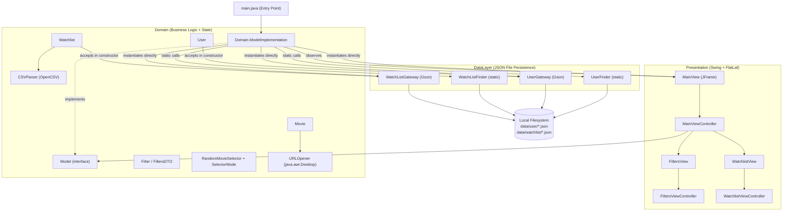
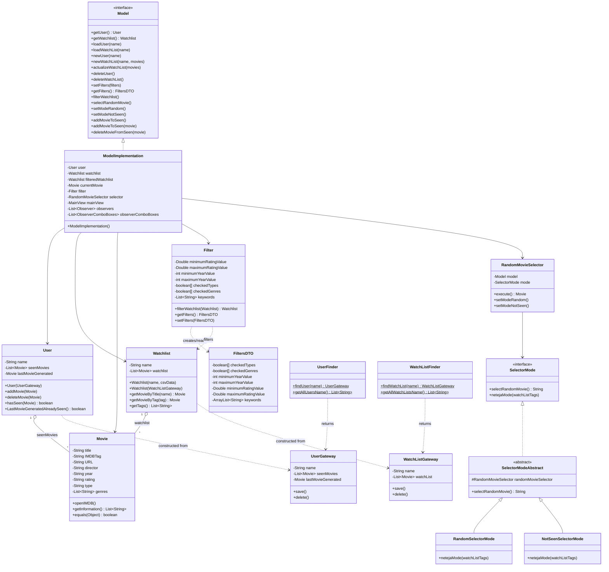
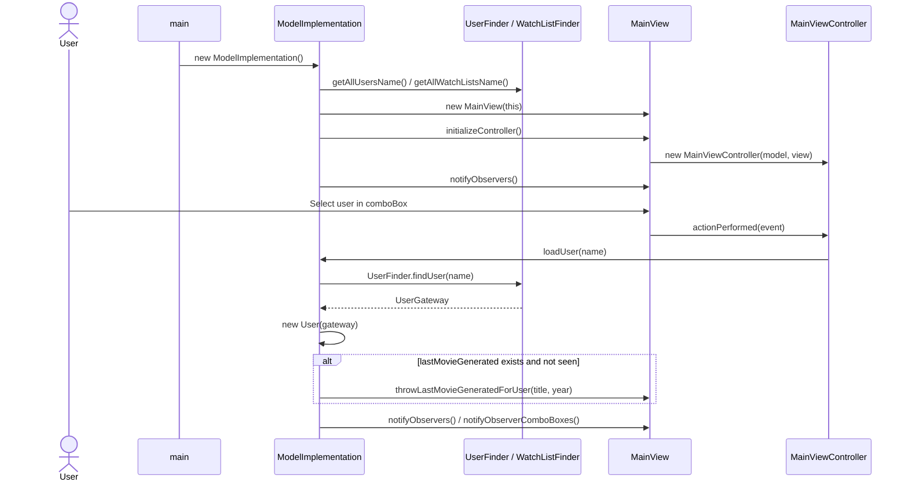
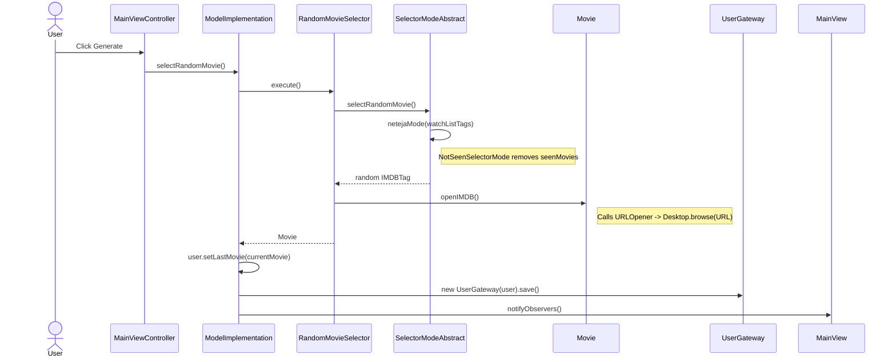

# Current Architecture Documentation (Legacy)

This document captures the **as-is** architecture of IMDBSelector prior to modernization.

---

## 1. Component & Dependency Overview

Notice the **inverted dependencies**: `Domain` directly imports and instantiates both `Presentation` (`MainView`) and `DataLayer` (`UserGateway`, `WatchListGateway`, `UserFinder`, `WatchListFinder`).

---

## 2. UML Class Diagram (Domain & DataLayer)

---

## 3. Key Sequence Flows

### Startup & User Selection

### Random Movie Selection

