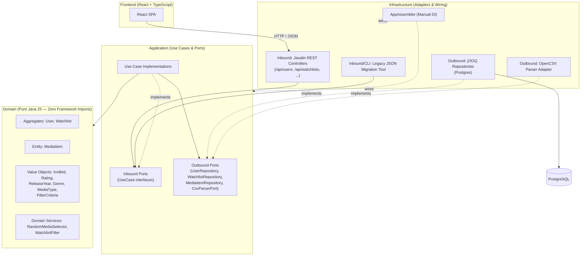
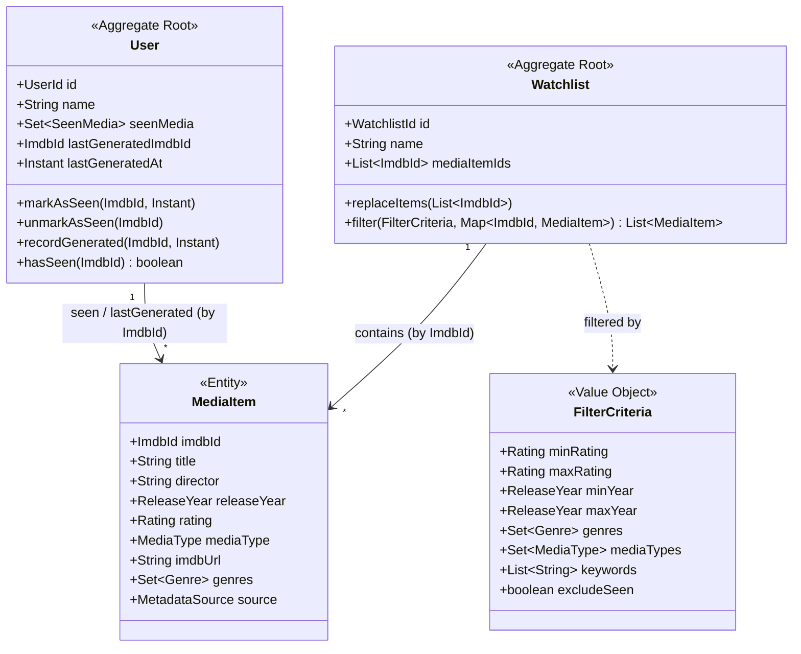
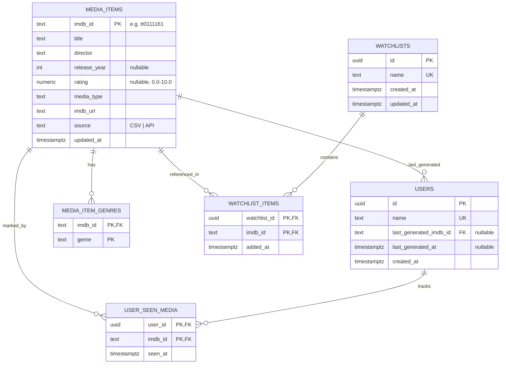

# Target Architecture & Design Specification

This document specifies the **proposed target design** for IMDBSelector, comparing against the legacy design in [current-architecture.md](current-architecture.md) so all architectural, schema, and API decisions can be reviewed before implementation.

---

## 1. Chosen Tech Stack

| Layer | Technology | Rationale |
| :--- | :--- | :--- |
| **Backend Language** | **Java 25** | Modern syntax (`record`, `sealed`, pattern matching, `Stream`s). |
| **Web / HTTP** | **Javalin** | Lightweight, explicit routing; zero DI magic. |
| **Persistence / SQL** | **jOOQ + Flyway + PostgreSQL** | Type-safe SQL, versioned migrations, zero ORM/JPA leakage into Domain. |
| **Build & Quality** | **Gradle (Kotlin DSL)**, **JUnit 5**, **Testcontainers**, **ArchUnit** | Single-command verification + automated hexagonal boundary enforcement. |
| **Frontend** | **React + TypeScript (Vite)** | Decoupled SPA communicating with the backend via stateless REST/JSON. |
| **Local Infra** | **Docker Compose** | Reproducible PostgreSQL instance for local dev and testing. |

---

## 2. Hexagonal Architecture (Ports & Adapters)

Unlike the legacy app (where `Domain` instantiated `MainView` and `UserGateway`), **all dependencies point inward** toward `domain`. Wiring happens in a single `AppAssembler` (`infrastructure/config`) using plain Java constructors.

---

## 3. Domain Model (DDD) vs. Legacy

### Key Changes from Legacy
1. **Normalized `MediaItem` catalog**: In legacy JSONs, full `Movie` objects were duplicated inside every `Watchlist` and every `User.seenMovies`. Now `MediaItem` is a canonical entity keyed by `ImdbId` (`tt...`), shared across watchlists and users—making future IMDB/TMDB enrichment clean.
2. **Rich Value Objects**: `Movie.year` (`String`), `Movie.rating` (`String`), and `Filter.checkedGenres` (`boolean[]`) become validated Java 25 `record`s (`ImdbId`, `ReleaseYear`, `Rating`, `Set<Genre>`, `Set<MediaType>`).
3. **Stateless Backend**: `ModelImplementation` no longer holds "current user/watchlist/movie" in memory. The React frontend holds the active selection and passes IDs/filters in REST requests.

---

## 4. PostgreSQL Schema (ER Diagram)

Designed for **v1 parity** while remaining **extension-ready** (nullable `owner_user_id` or join tables can be added later for multi-user/auth, and `media_items` can gain `poster_url`, `runtime_minutes`, or `rotten_tomatoes_score` without touching `users` or `watchlists`).

---

## 5. Proposed Stateless REST API Contract

| Resource | Method & Path | Purpose |
| :--- | :--- | :--- |
| **Users** | `GET /api/users` | List all user profiles |
| | `POST /api/users` | Create a user profile |
| | `GET /api/users/{userId}` | Get profile + `lastGenerated` (for "mark as seen?" prompt) |
| | `DELETE /api/users/{userId}` | Delete a user profile |
| **Seen Media** | `GET /api/users/{userId}/seen` | List seen `imdbId`s / media items for a user |
| | `POST /api/users/{userId}/seen/{imdbId}` | Mark a media item as seen |
| | `DELETE /api/users/{userId}/seen/{imdbId}` | Remove a media item from seen |
| **Watchlists** | `GET /api/watchlists` | List all watchlists |
| | `POST /api/watchlists` | Create watchlist from uploaded IMDB CSV |
| | `PUT /api/watchlists/{watchlistId}/import` | Replace/update watchlist items from new CSV |
| | `GET /api/watchlists/{watchlistId}/items` | View media items in watchlist (supports filter query params + `userId` for seen status) |
| | `DELETE /api/watchlists/{watchlistId}` | Delete a watchlist |
| **Selection** | `POST /api/watchlists/{watchlistId}/select` | Pick a random media item matching `FilterCriteria`, optionally excluding `userId`'s seen media and updating `lastGenerated` |
